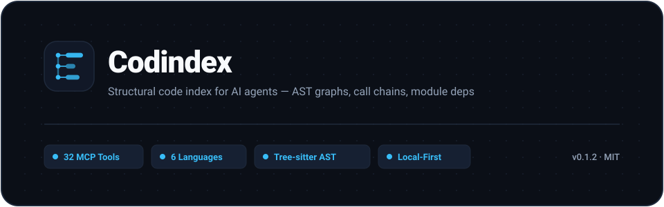

# Codindex

<p align="center">
  <picture>
    <source media="(prefers-color-scheme: dark)" srcset="assets/codindex-hero-dark.svg">
    <source media="(prefers-color-scheme: light)" srcset="assets/codindex-hero-light.svg">
    
  </picture>
</p>

<p align="center">
  <b>English</b> · <a href="README.md">简体中文</a>
</p>

<p align="center">
  <a href="https://www.npmjs.com/package/codindex"></a>
  <a href="#quick-start"></a>
  <a href="docs/TOOLS.md"></a>
  <a href="#supported-languages"></a>
  <a href="LICENSE"></a>
</p>

**A local-first codebase indexing (code indexing) and code intelligence server that hands your code's
structure to AI over MCP.** Codindex parses any repository with tree-sitter into a structural
index — functions, call graph and call chains, module dependency graph, control-flow graph —
stores it in a single SQLite file, and serves it to AI coding agents through 32 MCP tools.

It's static analysis and code analysis turned into an interface an agent can actually query,
instead of making it guess at code structure with regex.

So the agent doesn't have to grep and read files one by one to learn what's in the repo,
who calls what, and what a change will break.

- **Local-first** — no LLM API calls, no source upload, no telemetry
- **Structural** — call edges parsed from the AST, not guessed from text
- **Fast** — self-scan of 38 files / 145 functions / 7,570 call edges in 3.4s

Works as an MCP server with Claude Code, Cursor, VS Code and any Model Context Protocol client.
Code search and code navigation run on SQLite FTS5; semantic clusters come from call-graph BFS.
What comes out is a queryable code graph.

---

## What it answers

| You want to know | Doing it with grep | Codindex |
|---|---|---|
| Who calls `scanProject`? | Regex the name; cross-file, aliases and method calls are guesswork | `get_call_graph` |
| What breaks if I change this function? | Trace by hand, easy to miss paths | `get_impact_analysis` |
| What does this module depend on? Any cycles? | Import regex can't resolve path aliases | `get_module_deps` |
| Which functions are never called? | Practically impossible | `get_dead_code` |
| Is there already a reusable implementation? | Memory and full-text search | `get_reuse_report` |
| What do this function's branches and loops look like? | Read the source and picture it | `get_cfg` |

> Measured on the CodeGraph repo (146 TS files): the AST found 1,926 functions,
> while an agent counting with grep found ~951 — off by half, and grep gets no call
> relationships at all.

---

## Quick start

Requires Node.js ≥ 22.5 (for the built-in `node:sqlite`).

```bash
npm i -g codindex
```

Then:

```bash
codindex --version   # confirm the installed version
codindex --mcp       # MCP stdio mode, mount it in your editor
codindex             # Web UI → http://localhost:3100
```

**Install from source** (when you want to change code or run the tests):

```bash
git clone https://github.com/Bencibr/codeindex.git codindex && cd codindex
npm install && npm run build
npm pack && npm i -g ./codindex-*.tgz
```

The repo's `.npmrc` sets `legacy-peer-deps=true` (the tree-sitter grammar packages declare
conflicting peer ranges), so plain `npm install` works — no extra flags needed.
Use `npm run dev` to serve from source and `npm test` to run the suite (325 cases).

> If you see `npm warn allow-scripts tree-sitter-* (install: node-gyp-build)`, that's
> expected: the grammar packages ship prebuilt binaries, so skipping the install script
> costs nothing. To silence it, run `npm approve-scripts --allow-scripts-pending`.

### Index a project

Any one of these:

```bash
# Web UI: open http://localhost:3100, enter a name and path, click Add → Scan
```

```bash
# API
curl -X POST http://localhost:3100/api/projects \
  -H "Content-Type: application/json" \
  -d '{"name":"My Project","path":"/path/to/your/project"}'
curl -X POST http://localhost:3100/api/projects/{id}/scan
```

```
// MCP
add_project { name: "My Project", path: "/path/to/your/project" }
scan_project { project_id: "xxx" }
```

### Verify it works end to end

Four steps, using this repo itself as the target:

**1. Start the server**

```bash
codindex          # Web UI → http://localhost:3100
```

**2. Register the project** — the `id` in the response is the `project_id` for everything after

```bash
curl -X POST http://localhost:3100/api/projects \
  -H "Content-Type: application/json" \
  -d '{"name":"Codindex","path":"/path/to/codindex"}'
# → {"id":"bace225b-...","name":"Codindex","status":"pending", ...}
```

**3. Scan** — runs synchronously, the response means it is done

```bash
curl -X POST http://localhost:3100/api/projects/bace225b-.../scan
# → {"status":"complete","files":38,"functions":145,"calls":7572,"types":31,"cycles":0}
```

**4. Confirm you can query it**

```bash
curl http://localhost:3100/api/projects/bace225b-.../overview
# → {"name":"Codindex","status":"ready","lastScanned":1794213971, ...}
```

Or over MCP: `add_project` → `scan_project` → `get_project_summary`, which returns
`{files: 38, functions: 145, types: 31, calls: 7568, modules: 9}`.

If `status` is `"ready"` and the function count is non-zero, the whole path works.

---

## MCP setup

**Claude Code** — after a global install, just use the `codindex` binary (simplest):

```json
{
  "mcpServers": {
    "codindex": {
      "command": "codindex",
      "args": ["--mcp"],
      "env": { "CODINDEX_DB": "/absolute/path/to/codindex.db" }
    }
  }
}
```

Or: `claude mcp add codindex -- codindex --mcp`

**Without a global install**, you can run the cloned source directly
(the clone must already have `npm install` run):

```json
{
  "mcpServers": {
    "codindex": {
      "command": "npx",
      "args": ["tsx", "/absolute/path/to/codindex/src/index.ts", "--mcp"]
    }
  }
}
```

**Cursor / VS Code** — same block in `.cursor/mcp.json` or `.vscode/mcp.json`,
with the outer key renamed to `"servers"`.

> `CODINDEX_DB` must be an absolute path, or the MCP subprocess may not find the database.

---

## 32 tools

Full list with parameters and return shapes: **[docs/TOOLS.md](docs/TOOLS.md)**.

| Category | Count | Highlights |
|---|---|---|
| Context & reading | 6 | `get_smart_context` (3 depths), `get_context_bundle`, `get_function_context`, `get_function_body`, `get_function_list`, `get_file_content` |
| Calls & impact | 5 | `get_call_graph`, `get_impact_analysis`, `get_bulk_impact`, `get_dead_code`, `get_raise_sites` |
| Search | 3 | `search_code` (FTS5), `search_semantic` (call-graph BFS clusters), `find_similar_functions` |
| Structure | 8 | `get_project_summary`, `get_architecture_guide`, `get_module_deps`, `get_cfg`, `get_type_info`, `get_type_usage`, `get_export_inventory`, `get_bridge_map` |
| Quality & tracking | 5 | `get_hotspots`, `get_reuse_report`, `get_test_coverage`, `get_change_guide`, `get_feature_tracking` |
| Scanning | 5 | `add_project`, `scan_project`, `scan_project_incremental`, `start_watching`, `stop_watching` |
| **Total** | **32** | |

`get_smart_context` is the workhorse — it returns as much as you need and no more:

| purpose | Returns | Use when |
|---|---|---|
| `explore` | Summary + file + complexity + caller count | You just want to know what it does |
| `understand` | + callers + callees + related types | You need its role in the system |
| `modify` | + full source + impacted files | You're about to change it |

---

## Performance

**Scanning**: ~9s → ~3.5s after batching inserts, batching the reuse-score UPDATE,
and replacing a nested loop with a Map index. This repo self-scans in 3.4s including process start.

**AI efficiency**: we ran two experiments and the results disagree. Both are below.

| Round | Sample | Tool calls | Payload |
|---|---|---|---|
| 1 | Single question (architecture overview) | 8 vs 17, **−53%** | 64KB vs 1.4MB, **−95%** |
| 2 | 3 questions | 31 vs 28, **+11%** | — |

**What reliably improves** is the payload of a single answer: a structured query returns
tens of thousands of characters instead of hundreds of thousands of source. Both rounds agree.
**What we can't promise** is fewer tool calls — that depends on whether the agent actually
trusts and prefers these tools, which varies with prompt and model version.
The −53% from round 1 did not reproduce. Raw logs live in `src/tests/bench/`.

---

## FAQ

**Is this vector search / RAG?**
No. No embeddings, no vector store, no model API calls. The name `search_semantic` is
easy to misread — it does a BFS over the call graph, returning seed functions plus their
call neighbors. Results are reproducible and auditable.

**Does it need network access or upload my code?**
No. Everything lands in a single SQLite file (default `data/codindex.db`).

**How is this different from LSP / IDE go-to-definition?**
LSP serves instant navigation inside an editor. Codindex serves "hand the whole repo's
structure to an AI at once" — batch, queryable, reusable across sessions, and it computes
impact, reuse scores and dead code. They don't conflict.

**Does the data go stale?**
After `start_watching`, file changes sync within 3 seconds. Every response carries
`lastModified` so you can check freshness.

### Install / runtime problems

| Symptom | Cause | Fix |
|---|---|---|
| `npm install` fails with `ERESOLVE could not resolve` | tree-sitter grammars declare mutually exclusive peer ranges (java `^0.21.1`, python/rust `^0.22.1`) | The repo's `.npmrc` already sets `legacy-peer-deps=true`. If you removed it or ran outside the repo root, add `--legacy-peer-deps` |
| `codindex: command not found` | npm's global bin dir isn't on `PATH` | Check `npm config get prefix`, add `<prefix>/bin` to `PATH` |
| Port already in use on startup | 3100 is taken (possibly by an IDE extension) | `PORT=3199 codindex` |
| MCP connects but queries return nothing / empty DB | `CODINDEX_DB` is a relative path, and the MCP subprocess has a different cwd than your shell | Always use an **absolute** path, or omit it and use the default `data/codindex.db` |
| Function count is 0 but files aren't | Language unsupported, or file exceeds 1MB | See [Supported languages](#supported-languages) |
| Code changed but results didn't | Not rescanned, or watching is off | Call `scan_project_incremental`, or `start_watching` |
| Want a clean slate | Derived data is always rebuildable | Stop the processes, delete `data/codindex.db*`, rescan |

The `.npmrc` point is the one people trip on: it only applies when you run `npm install`
**from the repo root**. Running it in a subdirectory or elsewhere brings `ERESOLVE` back.

---

## Supported languages

| Language | Extensions | Extracted |
|---|---|---|
| TypeScript | `.ts` `.tsx` | functions/methods/arrow fns, call edges, types, imports |
| JavaScript | `.js` `.jsx` `.mjs` `.cjs` | same as above |
| Python | `.py` | functions/methods, call edges, class fields |
| Go | `.go` | functions/methods (receiver), call edges, struct fields |
| Rust | `.rs` | functions/methods, call edges, struct/enum fields |
| Java | `.java` | methods, call edges, class fields |

1MB per-file cap. Unlisted languages are not indexed — we'd rather support fewer languages
than report a file count with zero functions parsed out of it.

---

## Stack

Node.js ≥ 22.5 + TypeScript (ESM) · Tree-sitter · SQLite (built-in `node:sqlite`,
optionally better-sqlite3) + Drizzle ORM + FTS5 · Hono · React 18 + MUI 5 (CDN, no build step)
· @modelcontextprotocol/sdk · chokidar · Vitest

---

## Docs

| Document | Contents |
|---|---|
| [docs/TOOLS.md](docs/TOOLS.md) | All 32 tools, 4 resources and 1 prompt: parameters, returns, function-name resolution (Chinese) |
| [docs/API.md](docs/API.md) | Web API routes, Web UI pages, environment variables, PRD feature tracking (Chinese) |
| [CHANGELOG.md](CHANGELOG.md) | Changelog (Chinese) |
| [AGENTS.md](AGENTS.md) / [CLAUDE.md](CLAUDE.md) | Usage guide written for AI assistants (Chinese) |
| [CONTRIBUTING.md](CONTRIBUTING.md) | Dev setup, PR checklist, adding a language (English) |
| [SECURITY.md](SECURITY.md) | Vulnerability reporting and security boundaries (English) |
| [docs/REGRESSION-REPORT.md](docs/REGRESSION-REPORT.md) | Regression test report (Chinese) |

Common commands:

```bash
npm run dev        # tsx, picks up changes immediately
npx tsc --noEmit   # full typecheck, tests included
npm test           # 14 files / 325 tests (temp DB, never touches data/)
npm run build      # output in dist/
codindex --help    # CLI usage
```

---

## License

MIT
